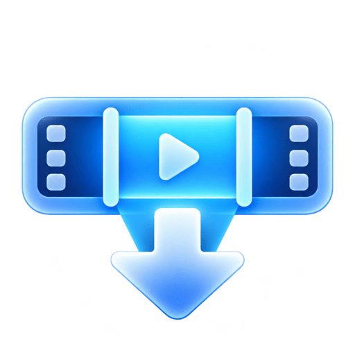
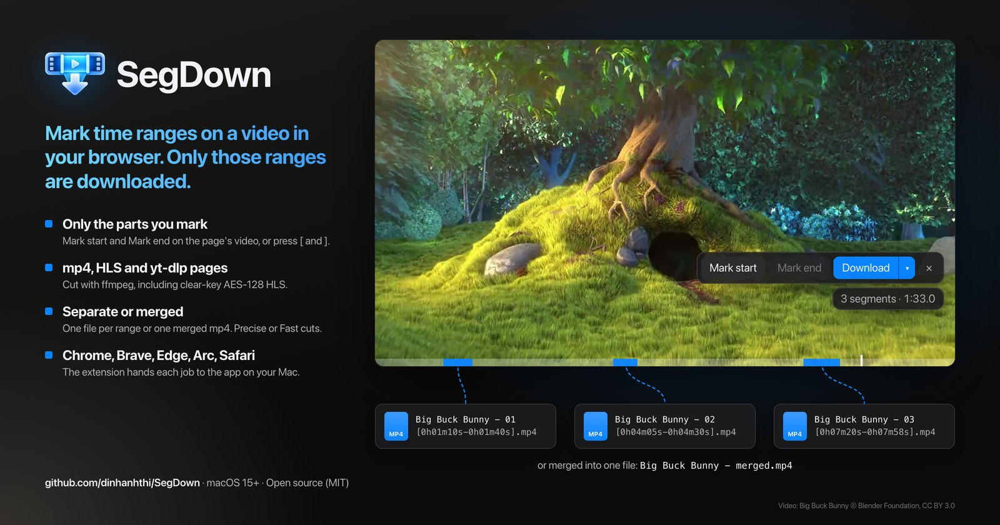

<div align="center">



# SegDown

**Mark time ranges on a video in your browser. Only those ranges are downloaded.**

[](LICENSE)




</div>

## Features

- A browser extension (Chrome, Chromium, Brave, Edge, Arc and Safari) puts a segment bar on the page's video: mark ranges with Mark start / Mark end or `[` / `]`, or take the whole video with Full clip.
- The SegDown app on your Mac downloads only those ranges: direct mp4 and HLS (including clear-key AES-128) with `ffmpeg`, and pages that `yt-dlp` supports with `yt-dlp`.
- One file per range, or all ranges merged into one mp4.
- Precise cuts (re-encoded, exact times) or Fast cuts (no re-encoding, nearest keyframes).
- Optional compression, size and duration limits, and incognito downloads that stay out of the history.

## Install

Requires macOS 15 or later, and:

```sh
brew install yt-dlp ffmpeg deno
```

ffmpeg must be 7.1 or later.

Download `SegDown-X.Y.Z.dmg` from the [latest release](https://github.com/dinhanhthi/SegDown/releases/latest), drag SegDown to `/Applications` and open it. It lives in the menu bar; its Dependencies page shows any missing tool and upgrades an outdated yt-dlp, deno or ffmpeg in one click.

Updates: Check for Updates… in the menu bar menu or the app menu.

## Build from source

Requires Xcode with Swift 6 and `brew install xcodegen`.

```sh
xcodegen generate
xcodebuild -project SegDown.xcodeproj -scheme SegDown -configuration Debug build
xcodebuild -project SegDown.xcodeproj -scheme SegDown -configuration Debug -showBuildSettings | grep -m1 BUILT_PRODUCTS_DIR
```

Copy `SegDown.app` from that folder to `/Applications` and open it. Builds are signed with the maintainer's Developer ID: to build it yourself, change `DEVELOPMENT_TEAM` and `CODE_SIGN_IDENTITY` in `project.yml`.

## Connect a browser

**Chrome, Chromium, Brave, Edge, Arc**

1. Unzip `SegDown-extension-X.Y.Z.zip` from the [latest release](https://github.com/dinhanhthi/SegDown/releases/latest). Open the browser's extensions page (`chrome://extensions` in Chrome), turn on Developer mode, click Load unpacked and pick the `SegDown-extension/` folder (or `extension/` in a clone).
2. In SegDown, open Browsers and click Install. Click Reinstall after moving the app.
3. Reload the pages that were already open.

After each update, replace the `SegDown-extension/` folder with the new release's and click reload on the extension.

**Safari** (the extension ships inside `SegDown.app`)

1. Open SegDown once.
2. Safari Settings › Extensions: tick SegDown, then "Always Allow on Every Website…". If it is unticked after replacing the app, tick it again.

## Use

1. Play the video, so the extension sees its media.
2. Click the SegDown icon at the top-left of the video (it shows while the pointer is over it), click the SegDown toolbar button, or press Alt+Shift+S.
3. Mark the ranges: Mark start / Mark end, or `[` / `]`.
4. Click Download. The ▾ menu picks separate or merged files, incognito, quality, source or video. For yt-dlp downloads (YouTube and the like), Quality sets the resolution: Best, or the tallest format up to a height such as 720p. Full clip downloads the whole video instead and leaves the ranges as they are (not for live video, or video longer than the Max total duration).
5. Follow the progress on the overlay or in the app's Downloads page.

Files land in `~/Downloads/SegDown/<page title>/` (change it in Settings). Settings › Output can also save every file straight into that folder (Flatten output folder) and name files in snake_case (`my_video_title_merged.mp4`).

Settings › Browser turns off the Full clip button and the icon on videos. A change reaches the browser the next time you open the overlay. A browser connected after the change gets the settings on its first page load once the extension can reach the app.

## Not supported

DRM-protected video (Widevine, FairPlay), live streams and DASH (`.mpd`). If a site blocks `yt-dlp`, upgrade it from the Dependencies page (or run `brew upgrade yt-dlp`).

## License

[MIT](LICENSE)
